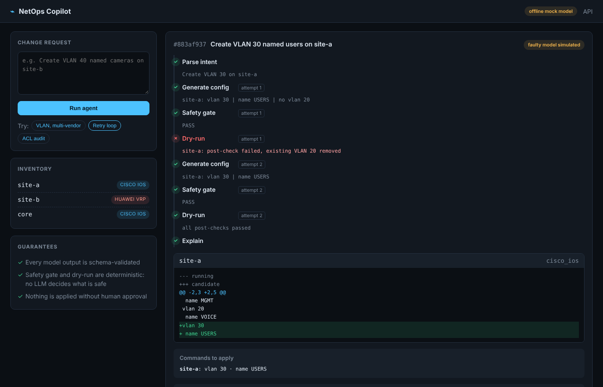

# NetOps Copilot

[](https://github.com/gokunguru/netops-copilot/actions/workflows/ci.yml)

> An AI agent that turns plain-language network change requests into validated, multi-vendor configs. A deterministic safety gate and dry-run decide what is safe, a human approves, and every applied change ships with an Ansible playbook, a rollback proven to restore the original, and a tamper-evident journal entry.

Built for the **Meta Global AI Developer Hackathon** (Indie track, theme: *Build for Your World*), Oct 26 – Nov 4, 2026.

## The problem

In network operations, writing the automation is rarely the bottleneck. The hard part is turning a ticket ("add VLAN 30 on sites A and B", "check ACL compliance") into correct vendor-specific config, then proving it is safe before it reaches production. LLMs can draft configs, but nobody should push LLM output to a router without guarantees.

## How it works

```
change request ─► [1] parse ─► [2] generate ─► [3] safety gate ─► [4] dry-run ─► [5] explain ─► [6] approve ─► [7] apply
 (plain text)    Muse Spark    Muse Spark      deterministic      deterministic   Muse Spark      human          deterministic
                                    ▲                │                 │
                                    └── retry with errors (bounded) ◄──┘
```

1. **Parse**: Muse Spark turns the request into a structured intent, validated by a schema (devices must exist, VLAN ids and names, ports and protocols).
2. **Generate**: Muse Spark writes vendor-specific commands for each device (Cisco IOS, Huawei VRP).
3. **Safety gate**: rule-based, no LLM. Blast radius, forbidden commands, protected VLANs, add-only during ACL fixes. `PASS` or `REJECT`.
4. **Dry-run**: the commands are applied to an **offline model of each device's config** with each vendor's grammar, then post-checks run on the result (see the safety layers below).
5. **Explain**: Muse Spark summarises the change and its risk, grounded in the facts the checks verified.
6. **Approve**: nothing happens without an explicit human decision.
7. **Apply**: the validated config becomes the new lab state, with an Ansible playbook, a verified rollback and a journal entry. Re-run the audit and you see the effect; roll back and you see it disappear.

When step 3 or 4 fails, the errors go back to the model and it tries again, within a fixed retry budget.

## Use cases

- **VLAN provisioning** on Cisco IOS and Huawei VRP
- **ACL compliance audit**, read-only: the policy in plain language, a verdict per interface and flow
- **ACL auto-remediation**: audit, fix only what is non-compliant, prove the fix, approve, apply, roll back

## Web UI

```bash
netops-copilot-web --mock     # offline, then open http://127.0.0.1:8000
netops-copilot-web            # live on Muse Spark (needs META_API_KEY)
```



Each pipeline step streams to the browser as it completes (Server-Sent Events): parse, generate, safety gate, dry-run, retry, explain. Changes end with **Approve / Reject**; audits show a compliance table with the rule or vendor default that decided each flow. Stack: FastAPI, HTMX, Jinja2, no JavaScript build step.

The same pipeline is exposed as a REST API (`POST /api/runs`, `GET /api/inventory`), documented at `/docs`, so it can be called from a ticketing or ITSM workflow.

## CLI demo

```bash
netops-copilot "Create VLAN 30 named users on site-a and site-b"          # real run on Muse Spark
netops-copilot "Create VLAN 30 named users on site-a and site-b" --mock   # offline, no API key
netops-copilot "Create VLAN 30 named users on site-a" --mock-faulty       # shows the retry loop
```

`--mock-faulty` makes the model first propose a change that silently deletes VLAN 20. The dry-run post-checks catch it, the errors go back to the model, and the second attempt is clean:

```
Attempt 1: gate PASS, dry-run FAILED -> FAILED
  site-a (cisco_ios): vlan 30 | name USERS | no vlan 20
  ! site-a: post-check failed, existing VLAN 20 removed

Attempt 2: gate PASS, dry-run OK -> OK
  site-a (cisco_ios): vlan 30 | name USERS
```

### ACL compliance audit

```bash
netops-copilot "Telnet and SMB must be blocked and HTTPS allowed on all edge ACLs" --mock
```

Muse Spark only translates the policy into test flows (`telnet` → `tcp/23 deny`). The verdict comes from a deterministic first-match engine that knows each vendor's default action:

```
ACL audit: NON-COMPLIANT (4 of 9 checks failed)
OK   site-a GigabitEthernet0/0 acl=EDGE-IN telnet (tcp/23): expected deny, actual deny <- 20 deny tcp any any eq telnet
FAIL site-a GigabitEthernet0/0 acl=EDGE-IN smb (tcp/445): expected deny, actual permit <- 40 permit ip any any
FAIL site-b GigabitEthernet0/0/0 acl=3000 telnet (tcp/23): expected deny, actual permit <- no rule matched: Huawei traffic-filter default permit
FAIL core (all) acl=(none) telnet (tcp/23): expected deny, actual permit <- no inbound ACL applied on any interface
...
```

The site-b finding is the kind that slips through manual reviews: Cisco ACLs end with an implicit deny, but a Huawei `traffic-filter` **permits** packets that match no rule. The engine also treats a rule restricted to one host as not blocking the service for everyone, and flags ACLs that are applied but never defined. Exit code is `0` when compliant and `3` when not, so the audit can run in CI.

### ACL auto-remediation

```bash
netops-copilot "Fix the edge ACLs: telnet and SMB must be blocked and HTTPS allowed" --mock-faulty
```

The agent audits, then generates a fix **only for the non-compliant devices**. A fix is accepted only if the dry-run proves it on the candidate config:

1. **Scope**: filtering may only change on the interfaces the audit flagged. A fix that also drops an ACL on an access port is rejected, even if it is otherwise correct.
2. **Re-audit**: every policy flow must now be compliant, on every interface.
3. **Collateral check**: common services outside the policy (SSH, DNS, NTP, SNMP, BGP, RDP, ping…) must behave exactly as before.
4. **Add-only**: the gate rejects any removal of a rule, an ACL or a binding during a remediation.

With `--mock-faulty`, the model makes the classic mistake: it creates a new Cisco ACL for `core` without the final `permit ip any any`. The implicit deny would have cut the uplink. The dry-run catches it and the second attempt is clean:

```
Attempt 1: gate PASS, dry-run FAILED -> FAILED
  ! core: still non-compliant after fix, https on GigabitEthernet0/0 is deny <- implicit deny (end of Cisco ACL)
  ! core: collateral change on GigabitEthernet0/0, ssh, dns, http, ntp, snmp, bgp, rdp, ping permit -> deny (not requested by the policy)

Attempt 2: gate PASS, dry-run OK -> OK
  core (cisco_ios): ip access-list extended NETOPS-EDGE-IN | 10 deny tcp any any eq 23 | 20 deny tcp any any eq 445 | 1000 permit ip any any | interface GigabitEthernet0/0 | ip access-group NETOPS-EDGE-IN in
```

The explanation step receives these verified facts (including vendor defaults such as Huawei's default permit), so the model's risk summary cannot contradict the deterministic checks.

New rules are inserted **before** the rule that let the traffic through (first-match), using each vendor's syntax. Commands that do not parse, or that target an interface that does not exist, are rejected by the config editor before any check runs.

### Safety layers

The safety layers are independent:

| Layer | Catches | LLM involved |
|---|---|---|
| Intent validation | unknown devices, invalid VLAN id or name | no |
| Safety gate | out-of-scope devices, forbidden commands (`reload`, `no router`, `undo local-user`…), VLAN 1 and reserved ranges, any removal during an ACL fix | no |
| Dry-run post-checks | wrong-vendor syntax, missing VLAN, existing VLAN removed or renamed, collateral VLANs | no |
| ACL fix proof | filtering changed on an interface the audit did not flag, policy still violated after the fix, collateral change on services outside the policy, invalid ACL syntax | no |
| Human approval | everything else | no |

## After "Approve"

```bash
netops-copilot "Fix the edge ACLs: telnet and SMB must be blocked and HTTPS allowed" --mock --yes
netops-copilot "Telnet and SMB must be blocked and HTTPS allowed on all edge ACLs" --mock   # now COMPLIANT
netops-copilot --history
netops-copilot --rollback <change-id>                                                         # NON-COMPLIANT again
netops-copilot --reset-lab
```

```
Change 30bff67275 applied to the lab by kamil (journal #1).
  rollback site-a: ip access-list extended EDGE-IN | no 1
  rollback site-b: acl number 3000 | undo rule 1
  rollback core: interface GigabitEthernet0/0 | no ip access-group NETOPS-EDGE-IN in | no ip access-list extended NETOPS-EDGE-IN
  Ansible: .netops/changes/30bff67275/playbook.yml  (rollback.yml, inventory.yml alongside)
```

- **What was validated is what gets applied**: the new config comes from the same editor the dry-run uses; for VLANs it is cross-checked against the simulator.
- **No change without a proven rollback**: the inverse commands are derived from the config diff, ordered for a live device (unbind before deleting an ACL), then **replayed on the new config and required to restore the original exactly**. If that cannot be proven, the change is refused.
- **No stale approvals**: if the lab changed between the run and the approval, the change is refused. Same for a rollback over a later change.
- **Ansible artefacts**: `playbook.yml`, `rollback.yml` and `inventory.yml` per change, using `ansible.netcommon.cli_config` with a backup of the running config first. CI checks them with `ansible-playbook --syntax-check`. Cisco hosts use `cisco.ios`; Huawei hosts use `community.network.ce`, which is no longer bundled with Ansible (`ansible-galaxy collection install community.network`).
- **Tamper-evident journal**: every apply and rollback is appended to `journal.jsonl`, each entry hashing the previous one. `--history` and `/api/changes` check the chain.

The same actions are in the web UI (Approve, playbook / rollback / inventory downloads, Roll back, change log, Reset lab) and in the API (`GET /api/changes`).

## Live devices (SSH)

The same pipeline drives real equipment. A device with a `driver` in the inventory is read and changed over SSH (Netmiko); the agent, the gate and the dry-run are unchanged, only the source of truth moves from the lab model to the device.

```bash
pip install -e ".[live]"
export DEVNET_USERNAME=...  DEVNET_PASSWORD=...        # from your sandbox reservation, never committed
netops-copilot --inventory lab/devnet.yml --probe      # version and interfaces
netops-copilot --inventory lab/devnet.yml "Fix the edge ACLs: telnet and SMB must be blocked and HTTPS allowed"
netops-copilot --inventory lab/devnet.yml --rollback <change-id>
```

[`lab/devnet.yml`](lab/devnet.yml) targets Cisco's public **Catalyst 8000 Always-On** sandbox (IOS XE).

What changes on a live device:

- **Explicit scope**: a live device must list its `edge` interfaces, and `protected` ones (the management interface the SSH session runs through) can never be filtered by the agent, whatever the model proposes.
- **Drift check before the push**, scoped to the blocks the change touches: someone else editing an unrelated part of a shared device does not block you, someone editing the same ACL or interface does.
- **Verified push**: the device must accept every command (Netmiko error patterns), then the running config is read back and the touched blocks must match the validated candidate. IOS rewrites `eq 23` as `eq telnet`, so the comparison is semantic, not textual.
- **Automatic rollback on any failure**, all-or-nothing across devices. If the device rejected a command half-way, the inverse is computed from what is really on the device, limited to the blocks the change touched, so other people's objects are never removed.
- **Evidence**: the running config before and after is stored with the change.
- Changes stay in the running config (no `write memory`).

## Scope and limits

- **Default lab is a model.** Without a `driver`, the dry-run and the lab state are offline models of each device's configuration (VLANs, ACLs, interface bindings) with Cisco IOS and Huawei VRP grammar; CI runs entirely on it. Live devices are supported over SSH (above); the live path is tested in CI against a fake IOS XE device that behaves like one seen through Netmiko.
- **Grammar coverage is deliberately narrow**: anything outside VLANs, extended ACLs and inbound bindings is rejected rather than guessed.

## CI/CD

```
push / PR ──► lint ──────┐
              tests ×3 ──┼──► container: build ─► smoke test ─► Trivy ──► publish to GHCR (main only)
              security ──┘                                                     ▲
              demos ─────────────────────────────────────────────────────────┘
```

Every push and pull request runs [the pipeline](.github/workflows/ci.yml), with no API key:

| Job | What it enforces |
|---|---|
| **Lint** | `ruff` on the code, `actionlint` + `shellcheck` on the workflows themselves |
| **Tests** | the suite on Python 3.11, 3.12 and 3.13, **fails under 88 % branch coverage**; coverage and JUnit reports kept as artifacts |
| **Security** | `gitleaks` on the full git history (no API key ever committed), `bandit` static analysis, `pip-audit` on dependencies |
| **Demos** | the CLI demos end to end on the offline model, asserting the retry loop and the lockout catch happen, then the closed loop: fix applied, audit compliant, rollback, audit non-compliant again; the generated playbooks pass `ansible-playbook --syntax-check` |
| **Container** | builds the image, runs it, probes `/healthz`, the UI and the REST API, checks it runs as a non-root user, then fails on any fixable HIGH or CRITICAL CVE (Trivy) |
| **Publish** | on `main` only, after everything above is green: pushes `ghcr.io/gokunguru/netops-copilot` tagged `latest` and with the commit SHA, with an SBOM and build provenance |

Supply-chain hygiene: every third-party action is pinned to a full commit SHA, the default token is read-only and only the publish job can write packages, and [Dependabot](.github/dependabot.yml) proposes weekly updates for Python packages, actions and the base image.

A separate [live smoke test](.github/workflows/live-smoke.yml) runs the three use cases against the real Muse Spark API. It costs tokens, so it is manual only (`Actions > Live smoke test > Run workflow`) and needs a `META_API_KEY` repository secret.

### Run it in a container

```bash
docker run --rm -p 8000:8000 ghcr.io/gokunguru/netops-copilot                     # offline model
docker run --rm -p 8000:8000 -e NETOPS_MOCK=0 -e META_API_KEY=... ghcr.io/gokunguru/netops-copilot   # Muse Spark
```

The image is a multi-stage build on `python:3.12-slim`, runs as an unprivileged user and ships a health check. The lab state lives in the container (`/home/netops/.netops`): mount a volume there to keep it.

## Stack

- **Models**: Muse Spark (`muse-spark-1.3`) via Meta Model API, OpenAI-compatible endpoint; any OpenAI-compatible endpoint serving Muse Spark Open works by changing `.env`
- **Agent**: Python 3.11+, Pydantic for every LLM output
- **Lab**: offline config models with Cisco IOS and Huawei VRP grammar
- **Hand-off**: Ansible (`ansible.netcommon.cli_config`)
- **UI and API**: FastAPI + HTMX (Server-Sent Events), Jinja2 templates

## Quickstart

```bash
git clone https://github.com/gokunguru/netops-copilot.git
cd netops-copilot
python -m venv .venv && source .venv/bin/activate
pip install -e ".[dev]"
cp .env.example .env   # add your Meta Model API key
pytest                 # 96 tests, no API key needed
```

## Built during the hackathon

Everything in this repository was written during the event (Oct 26 – Nov 4, 2026). The commit history is the record.

**Prior work and third-party resources**, not counted as hackathon work:

- My background in network automation (Ansible/Python on multi-vendor WAN) shaped the problem and use cases. No code or configuration from previous work is reused.

## License

MIT
